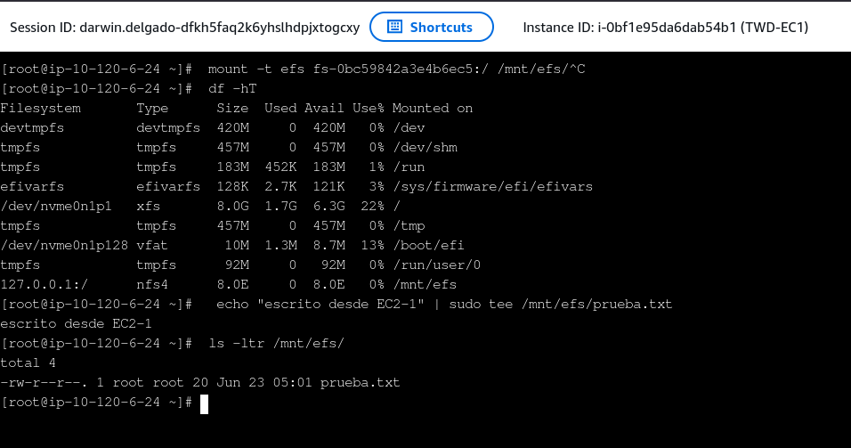
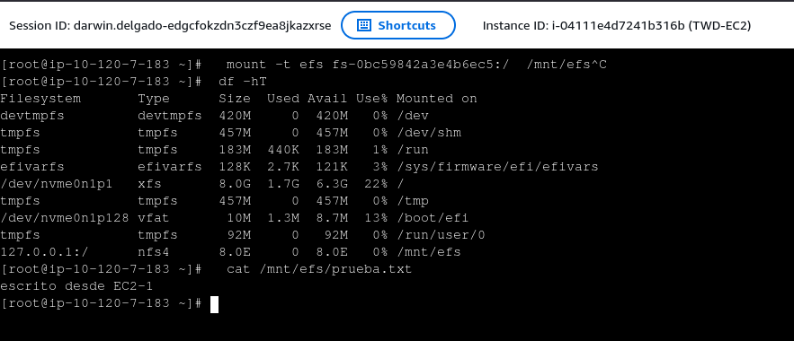

Quería que dos EC2, en dos Availability Zones distintas, leyeran y escribieran los mismos archivos en tiempo real — sin replicar nada a mano. Esto es EFS: un NFS administrado por AWS que montas en varias instancias a la vez.

<!--more-->



-----

## 1. Crea el filesystem

EFS → Create file system → Name: `training-efs`, VPC: `training-vpc`.

Customization: Storage class Standard, Throughput Elastic, encriptación at-rest activada.

En **File system policy**, marca **"Enforce in-transit encryption for all clients"** — obliga TLS en el tráfico NFS. Sin esto, los datos van en texto plano por la red.

Así queda el filesystem una vez creado:



## 2. Security Group para NFS

El mount target necesita recibir tráfico NFS en el puerto 2049 desde tus EC2.

EC2 → Security Groups → Create security group. Name: `training-sg-efs`.

Inbound rule: NFS, puerto 2049, source: SG de tus EC2.

Vuelve a EFS → tu filesystem → Network → edita los mount targets → asigna `training-sg-efs`.



## 3. Lanza dos EC2 en AZ diferentes

AZ-a y AZ-b. Ambas con IAM Role `AmazonSSMManagedInstanceCore` para acceder vía SSM Session Manager. OS: Amazon Linux 2.

## 4. Monta el filesystem en ambas

Vía SSM en cada EC2:

```bash
sudo dnf install -y amazon-efs-utils
sudo mkdir -p /mnt/efs
sudo mount -t efs fs-XXXXXXXX:/ /mnt/efs
```

El paquete amazon-efs-utils maneja el cifrado TLS automáticamente ("Enforce in-transit encryption" activado en el paso 1).

## 5. Verifica que funciona

**En EC2-1**, escribo un archivo de prueba::
```bash
echo "escrito desde EC2-1" | sudo tee /mnt/efs/prueba.txt
```

<figure style="margin: 2rem 0;">  <figcaption style="font-size: 0.85rem; color: #666; text-align: center; margin-top: 10px; font-style: italic;">EC2-1 montando el sistema de archivos y escribiendo el archivo de prueba</figcaption> </figure>

Si ejecutas df -h, notarás que EFS reporta una capacidad de 8.0E. Esto se debe a que es un sistema de archivos elástico; crece automáticamente y pagas solo por el GB/mes que realmente ocupas.

**En EC2-2** (situada en otra Availability Zone), leo el archivo:
```bash
cat /mnt/efs/prueba.txt
# Resultado: escrito desde EC2-1
```

<figure style="margin: 2rem 0;">  <figcaption style="font-size: 0.85rem; color: #666; text-align: center; margin-top: 10px; font-style: italic;">EC2-2 leyendo en tiempo real el archivo creado desde otra Availability Zone</figcaption> </figure>

¡Listo! El mismo archivo está disponible desde diferentes AZ, en tiempo real.

## 6. Monta persistente (opcional)

Para que el sistema de archivos se monte automáticamente cuando la instancia se reinicie, edito el /etc/fstab:
```bash
echo "fs-XXXXXXXX:/ /mnt/efs efs defaults,_netdev 0 0" | sudo tee -a /etc/fstab
```
El parámetro _netdev asegura que el sistema espere a tener red antes de intentar montar EFS, evitando errores en el arranque.
-----

Eso es todo. Nada de replicación manual, nada de sincronizar carpetas — el mount target se encarga.
