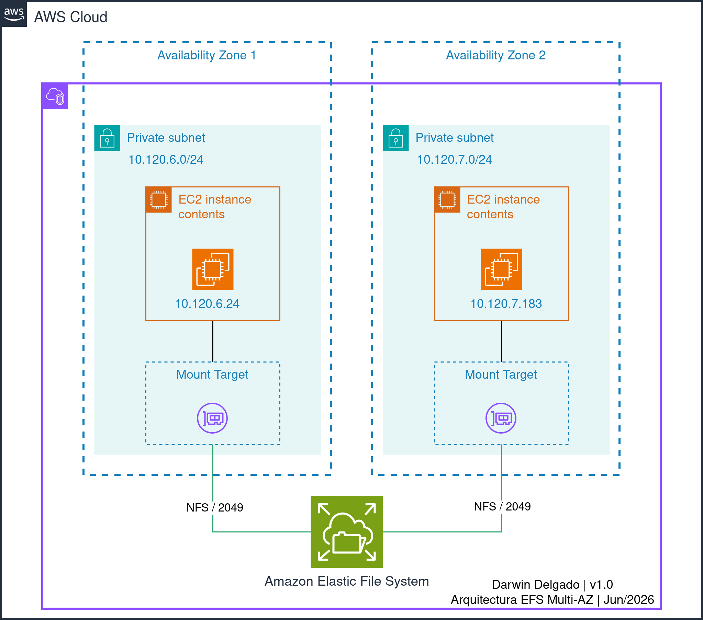
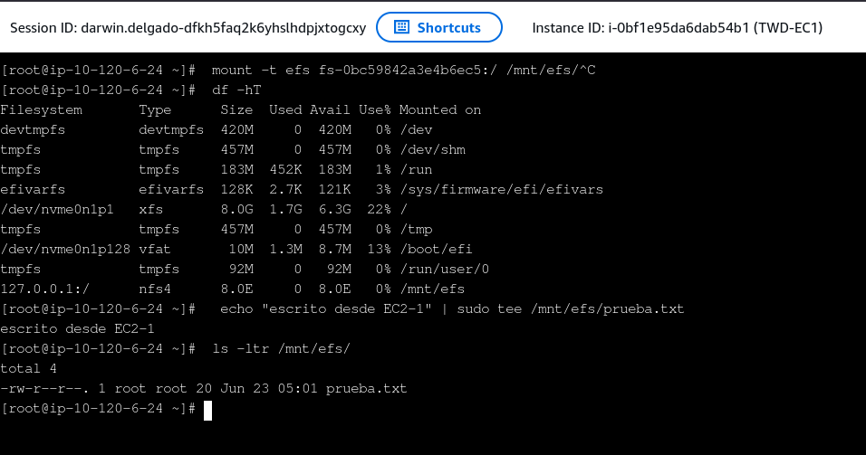
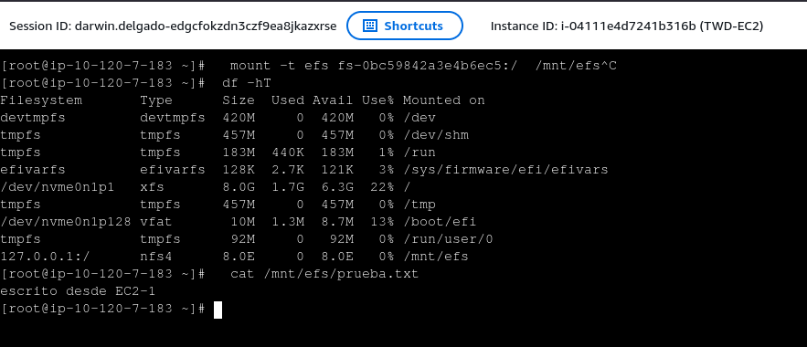

Si tienes dos instancias EC2 en distintas Availability Zones y necesitas que ambas lean y escriban los mismos archivos en tiempo real (sin usar Rsync ni copiar carpetas a mano), la respuesta es Amazon EFS. En esta guía **desplegaré** un sistema de archivos NFS administrado por AWS y te **mostraré** paso a paso cómo montarlo en ambas instancias para lograr una arquitectura Multi-AZ altamente disponible.

<!--more-->

<!-- DIAGRAMA PRINCIPAL: Ocupa el 100% del ancho, con bordes redondeados y sombra -->


-----

## 1. Creo el filesystem

Primero voy a la consola de EFS → Create file system → Name: `training-efs`, VPC: `training-vpc`.

En las opciones de personalización elijo: **Storage class** Standard, **Throughput** Elastic (así pago por lo que uso, ideal para cargas de trabajo variables) y activo la **encriptación at-rest**.

En **File system policy**, marco la opción **"Enforce in-transit encryption for all clients"**. Esto es crucial: obliga a que todo el tráfico NFS viaje cifrado con TLS. Sin esto, los datos viajarían en texto plano por la red.

Así queda el filesystem una vez creado:



## 2. Security Group y Arquitectura de Red (Multi-AZ)

El mount target necesita recibir tráfico NFS en el puerto 2049 desde mis EC2.

Voy a EC2 → Security Groups → Create security group. Name: `training-sg-efs`.
En la regla de entrada (Inbound rule) selecciono NFS, puerto 2049, y como source pongo **el Security Group de mis EC2**. *(Buena práctica: nunca abrir el puerto a `0.0.0.0/0`)*.

Vuelvo a EFS → mi filesystem → Network → edito los mount targets → asigno `training-sg-efs`.

> **Nota de Arquitectura:** Como tengo instancias en dos AZs distintas, AWS crea automáticamente un **Mount Target en cada AZ**. Esto es vital por dos razones: **Alta Disponibilidad** (si una AZ falla, la otra sigue accediendo) y **Bajo Latencia** (el tráfico no cruza entre zonas, evitando costos de transferencia y latencia).



## 3. Lanzo dos EC2 en AZ diferentes

Despliego dos instancias EC2 (una en la AZ-a y otra en la AZ-b) dentro de subredes privadas. A ambas les asigno el IAM Role `AmazonSSMManagedInstanceCore` para que pueda acceder a ellas de forma segura vía SSM Session Manager, sin necesidad de abrir el puerto 22. Uso Amazon Linux 2 como sistema operativo.

## 4. Monto el filesystem en ambas

Me conecto a cada EC2 vía SSM Session Manager y ejecuto:

```bash
sudo dnf install -y amazon-efs-utils
sudo mkdir -p /mnt/efs
sudo mount -t efs fs-XXXXXXXX:/ /mnt/efs
```

El paquete amazon-efs-utils maneja el cifrado TLS automáticamente ("Enforce in-transit encryption" activado en el paso 1).

## 5. Verifica que funciona

**En EC2-1**, escribo un archivo de prueba::
```bash
echo "escrito desde EC2-1" | sudo tee /mnt/efs/prueba.txt
```

<figure style="margin: 2rem 0;">  <figcaption style="font-size: 0.85rem; color: #666; text-align: center; margin-top: 10px; font-style: italic;">EC2-1 montando el sistema de archivos y escribiendo el archivo de prueba</figcaption> </figure>

> Si ejecutas **df -h**, notarás que EFS reporta una capacidad de 8.0E. Esto se debe a que es un sistema de archivos elástico; crece automáticamente y pagas solo por el GB/mes que realmente ocupas.

**En EC2-2** (situada en otra Availability Zone), leo el archivo:
```bash
cat /mnt/efs/prueba.txt
# Resultado: escrito desde EC2-1
```

<figure style="margin: 2rem 0;">  <figcaption style="font-size: 0.85rem; color: #666; text-align: center; margin-top: 10px; font-style: italic;">EC2-2 leyendo en tiempo real el archivo creado desde otra Availability Zone</figcaption> </figure>

¡Listo! El mismo archivo está disponible desde diferentes AZ, en tiempo real.

## 6. Monta persistente (opcional)

Para que el sistema de archivos se monte automáticamente cuando la instancia se reinicie, edito el /etc/fstab:
```bash
echo "fs-XXXXXXXX:/ /mnt/efs efs defaults,_netdev 0 0" | sudo tee -a /etc/fstab
```

El parámetro _netdev asegura que el sistema espere a tener red antes de intentar montar EFS, evitando errores en el arranque.

-----
